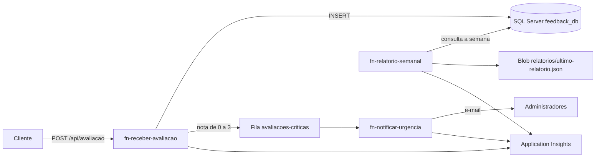

# Avaliações serverless

## Arquitetura



| Função | Function App | Gatilho | Responsabilidade |
| --- | --- | --- | --- |
| `fn-receber-avaliacao` | `ReceberAvaliacao` | HTTP `POST /api/avaliacao` | Valida a avaliação, grava no SQL Server e publica na fila só quando a urgência é crítica |
| `fn-notificar-urgencia` | `NotificarUrgencia` | `@QueueTrigger` na fila `avaliacoes-criticas` | Envia o e-mail com descrição, urgência e data de envio |
| `fn-relatorio-semanal` | `RelatorioSemanal` | `@TimerTrigger` toda segunda-feira às 08:00, horário de Brasília | Consulta a última semana e consolida média, quantidade por dia e quantidade por urgência |

As três Function Apps ficam no resource group `ReceberAvaliacao_group`, usam a storage account `receberavaliacaogrob4a3` e o Application Insights `ReceberAvaliacao`.

O `@QueueTrigger` lê a conta configurada em `AzureWebJobsStorage`. 

## Regras de negócio

`POST /api/avaliacao`

```json
{
  "descricao": "texto",
  "nota": 0
}
```

`nota` é um inteiro de 0 a 10. `descricao` é obrigatória.

| Nota | Urgência | Vai para a fila? |
| --- | --- | --- |
| 0 a 3 | `ALTA` | Sim. É uma avaliação crítica |
| 4 a 6 | `MEDIA` | Não |
| 7 a 10 | `BAIXA` | Não |

A resposta de sucesso informa o id, a urgência e se a mensagem foi enfileirada:

```json
{"mensagem":"Avaliação registrada.","id":1,"urgencia":"ALTA","enfileirada":true}
```

O e-mail de urgência leva a descrição, a urgência, a data de envio no horário de Brasília e a nota.

O relatório semanal cobre os sete dias anteriores e traz:

- média das notas
- quantidade e média por dia
- quantidade e média por urgência
- lista com descrição, urgência, data de envio e nota

O timer usa o fuso `E. South America Standard Time`, configurado em `WEBSITE_TIME_ZONE` na app `RelatorioSemanal`. Com o CRON `0 0 8 * * 1`.

## Monitoramento

O componente `ReceberAvaliacao` em Application Insights recebe a telemetria das três apps, porque todas usam a mesma `APPLICATIONINSIGHTS_CONNECTION_STRING`.

## Testando
A coleção do insomina está na pasta tech_challenge_in_feedback/insonmina
